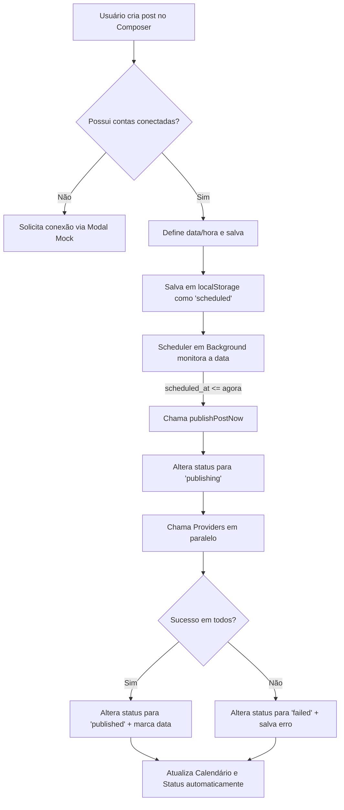

# Arquitetura - Publicador Automático (Automatic Publisher)

Este documento descreve a arquitetura, estrutura de arquivos, esquema de banco de dados e fluxo de execução do módulo **Publicador Automático** integrado ao PinkLogic.

---

## 1. Estrutura de Arquivos Criados e Modificados

### Novos Arquivos
- **Migração de Banco de Dados**:
  - [`supabase/migrations/20260525000000_create_publisher_tables.sql`](file:///c:/Users/Evand/Documents/PINK%20LOGIC/supabase/migrations/20260525000000_create_publisher_tables.sql): Script SQL DDL de criação das tabelas no Supabase.
- **Tipos TypeScript**:
  - [`src/types/publisher.ts`](file:///c:/Users/Evand/Documents/PINK%20LOGIC/src/types/publisher.ts): Definições de tipos e interfaces para posts agendados e contas sociais conectadas.
- **Providers de Publicação (Mockados)**:
  - [`src/lib/publishers/instagram.ts`](file:///c:/Users/Evand/Documents/PINK%20LOGIC/src/lib/publishers/instagram.ts): Regras e simulação de envio para Instagram.
  - [`src/lib/publishers/facebook.ts`](file:///c:/Users/Evand/Documents/PINK%20LOGIC/src/lib/publishers/facebook.ts): Regras e simulação de envio para Facebook.
  - [`src/lib/publishers/linkedin.ts`](file:///c:/Users/Evand/Documents/PINK%20LOGIC/src/lib/publishers/linkedin.ts): Regras e simulação de envio para LinkedIn.
  - [`src/lib/publishers/twitter.ts`](file:///c:/Users/Evand/Documents/PINK%20LOGIC/src/lib/publishers/twitter.ts): Regras e simulação de envio para X/Twitter.
  - [`src/lib/publishers/wordpress.ts`](file:///c:/Users/Evand/Documents/PINK%20LOGIC/src/lib/publishers/wordpress.ts): Regras e simulação de envio para WordPress.
  - [`src/lib/publishers/blog.ts`](file:///c:/Users/Evand/Documents/PINK%20LOGIC/src/lib/publishers/blog.ts): Regras e simulação de envio para o Blog Interno.
  - [`src/lib/publishers/index.ts`](file:///c:/Users/Evand/Documents/PINK%20LOGIC/src/lib/publishers/index.ts): Orquestrador central que recebe um post, transiciona seu estado e despacha em paralelo para os providers corretos.
- **Contexto React**:
  - [`src/contexts/PublisherContext.tsx`](file:///c:/Users/Evand/Documents/PINK%20LOGIC/src/contexts/PublisherContext.tsx): Provedor de estado que gerencia contas, fila de postagem, persistência local e simulação de agendamento em background (polling loop).
- **Interface Gráfica**:
  - [`src/pages/Gestao/PublicadorAutomatico.tsx`](file:///c:/Users/Evand/Documents/PINK%20LOGIC/src/pages/Gestao/PublicadorAutomatico.tsx): Rota `/publicador-automatico`. Contém o Composer, plataforma de preview interativo multicanal, seletor de agendamento, gerenciador de contas conectadas e tabela da fila de posts.
 
### Arquivos Modificados
- [`src/App.tsx`](file:///c:/Users/Evand/Documents/PINK%20LOGIC/src/App.tsx): Importação e wrapping do `PublisherProvider`, e adição da rota `/publicador-automatico`.
- [`src/components/Sidebar.tsx`](file:///c:/Users/Evand/Documents/PINK%20LOGIC/src/components/Sidebar.tsx): Adição do link do Publicador Automático no menu lateral sob a seção "Gestão".
- [`src/contexts/GestaoContext.tsx`](file:///c:/Users/Evand/Documents/PINK%20LOGIC/src/contexts/GestaoContext.tsx): Adaptação e mesclagem de posts agendados no estado global de posts para integração transparente com o **Calendário** editorial e o painel de **Status** do PinkLogic.
- [`src/translations/index.ts`](file:///c:/Users/Evand/Documents/PINK%20LOGIC/src/translations/index.ts): Inclusão da tradução da chave `sidebar.publicador` nos idiomas `pt`, `en` e `es`.

---

## 2. Tabelas do Banco de Dados (Supabase)

Foram especificadas duas tabelas principais de controle:

### `scheduled_posts`
Guarda todas as publicações criadas e agendadas pelo usuário:
- `id` (UUID, primary key)
- `user_id` (UUID, do usuário proprietário)
- `project_id` (UUID, opcional, vinculação ao projeto)
- `brand_id` (UUID, opcional, vinculação ao Brand Kit)
- `title` (TEXT, título interno)
- `caption` (TEXT, legenda principal)
- `hashtags` (TEXT[], array de hashtags do post)
- `media_url` (TEXT, link da imagem/mídia)
- `media_type` (TEXT, tipo de mídia: `image`/`video`)
- `platforms` (TEXT[], plataformas selecionadas para envio)
- `scheduled_at` (TIMESTAMPTZ, data/hora programada de disparo)
- `timezone` (TEXT, fuso horário selecionado)
- `status` (TEXT, padrão `'draft'`, estados: `'draft'`, `'scheduled'`, `'publishing'`, `'published'`, `'failed'`, `'cancelled'`)
- `error_message` (TEXT, logs de falhas das APIs se houver)
- `published_at` (TIMESTAMPTZ, timestamp de envio efetivo)
- `created_at` / `updated_at` (TIMESTAMPTZ, logs de auditoria)

### `social_accounts`
Armazena a relação e os tokens de integração das contas conectadas:
- `id` (UUID, primary key)
- `user_id` (UUID)
- `platform` (TEXT, plataforma integrada)
- `account_name` (TEXT, nome do usuário/perfil exibido)
- `access_token` (TEXT, token de acesso à API, criptografado/seguro no backend)
- `refresh_token` (TEXT, token de renovação)
- `expires_at` (TIMESTAMPTZ, expiração do token)
- `status` (TEXT, padrão `'disconnected'`, estados: `'connected'`, `'disconnected'`)
- `created_at` / `updated_at` (TIMESTAMPTZ, logs de auditoria)

---

## 3. Fluxo de Publicação e Scheduler

O fluxo de funcionamento do Publicador em modo simulado é definido da seguinte forma:

1. **Composer**: O usuário preenche os campos, seleciona os canais e clica em **Agendar**.
2. **Salvamento**: O post é inserido no `localStorage` com status `'scheduled'`.
3. **Agendador em Background**: Um loop intervalado (a cada 8 segundos) roda no `PublisherProvider` verificando posts vencidos (`scheduled_at <= now`).
4. **Execução**: Quando um post vence, a função assíncrona central `publishPost(postId)` é chamada:
   - Status muda para `'publishing'`.
   - Dispara em paralelo chamadas simuladas de rede para cada provider em `src/lib/publishers/`.
   - Se ocorrer sucesso, o status muda para `'published'`.
   - Se algum provider falhar, o status é marcado como `'failed'` e a string de erros compilada é registrada em `error_message`.
5. **Eventos**: Durante cada transição, eventos Custom DOM (`scheduled_posts_updated`) são disparados, forçando a sincronização reativa e imediata de todos os componentes da interface.

---

## 4. Instruções de Teste

Para validar a implementação localmente, siga estes passos:

1. **Acessar Rota**:
   - Abra a sidebar e clique em **Publicador Automático** sob a seção **Gestão** (ou navegue diretamente para `/publicador-automatico`).
2. **Conectar Contas**:
   - Veja as contas listadas no painel inferior. Clique em **Conectar** em qualquer uma delas, informe um nome de usuário simulado e confirme. O status mudará imediatamente para "Conectado".
3. **Escrever Post**:
   - No composer, insira um título, legenda, algumas hashtags e selecione uma das imagens modelo oferecidas.
   - Selecione os canais desejados (apenas canais conectados podem ser selecionados).
4. **Agendamento por Tempo**:
   - Configure a data e hora para cerca de **1 minuto no futuro** e clique em **Agendar Publicação**.
   - O post aparecerá imediatamente na tabela inferior ("Fila de Publicação") com status `Agendado`.
   - Aguarde o tempo expirar. Você verá o status mudar automaticamente para `Publicando...` e logo em seguida para `Publicado`.
5. **Forçar Envio Imediato**:
   - Você também pode clicar no ícone de envio (avião de papel) ao lado do post na fila para forçar o disparo imediato da simulação de publicação.
6. **Simular Erros de API**:
   - Para simular e testar o status de falha (`failed`), crie um post e insira o texto `fail-instagram`, `fail-facebook` ou `fail-linkedin` no título ou na legenda.
   - Dispare o post. A publicação falhará na plataforma correspondente, exibindo o ícone de alerta vermelho e o erro detalhado da API ao passar o mouse sobre o status.
7. **Integração com Calendário estratégico**:
   - Navegue para `/gestao/calendario`. O post agendado aparecerá no slot de horário correspondente com a tag `(Agendado)`. Você pode arrastá-lo e soltá-lo para novos horários e o sistema atualizará automaticamente a data de agendamento no publicador.
8. **Integração com Tela de Status**:
   - Navegue para `/gestao/status`. Os posts agendados e publicados também aparecerão na listagem geral de publicações.
